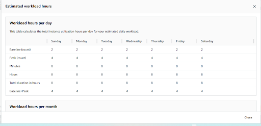
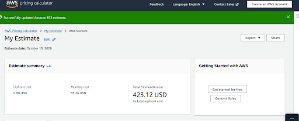

# Cloud cost estimation

## Problem

Estimate a modeled workload and compare a revised configuration. These are calculator results, not actual AWS bills or verified performance improvements.

## Workload inputs

The workload dialog records baseline and peak counts with an eight-hour daily duration.

The transfer calculation shows $0 inbound and $9 monthly outbound under the displayed calculator assumptions. These historical exercise figures are not a current pricing quotation.

## Initial and revised estimates

Initial estimate: $93.66 per month, $1,123.92 over twelve months, with $0 upfront.

Revised estimate: $35.26 per month, $423.12 over twelve months, with $0 upfront.

The displayed totals differ by $58.40 monthly, $700.80 annually, or approximately 62.4%. The user reports changing to t2.micro as part of the exercise; the selected instance type is not visible in these summary images. No claim is made that performance was equal or that these savings were realized in production.

## Lesson

Document workload assumptions alongside totals. Cost reduction should be accepted only after performance, capacity and availability needs are evaluated; a lower calculator result alone does not establish an appropriate production configuration.
