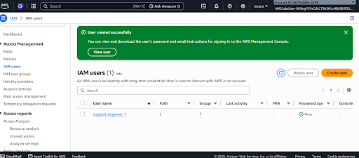

# IAM group and support-user configuration

## Problem

Support staff need resource visibility without unnecessary change authority. This lab uses group membership and an AWS managed read-only policy to organize that access.

## Actions and evidence

### Created the support group

The console confirms SupportEngineers was created. At this stage it had zero users.

### Selected group-based permissions for a new user

The create-user wizard selects SupportEngineers and shows AmazonEC2ReadOnlyAccess attached to that group. This records the permission selection; it does not test every effective permission.

### Completed user creation

The success banner and IAM list show support-engineer-1 was created. The group-count column indicates one membership; the earlier wizard records the intended group.

## Lessons and verification limits

Group-based assignment makes responsibilities easier to review. Managed read-only policies are a training starting point; production permissions require a job-specific review and tests using the intended principal.

The supplied 403 image is an instructional Practice screen, so it is excluded. A live denial screenshot or request output is still needed before claiming a tested termination restriction. The supplied RDS DIY images show the goal and a populated form, not a successful validation result; they are excluded too. No RDS attachment or denied-action proof is inferred from these three action screenshots.
