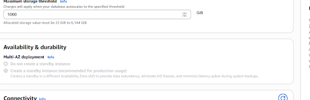
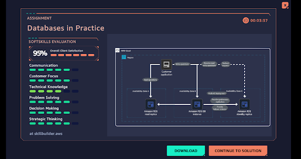

# Databases in Practice Lab

Secure, available database design for an insurance-company client (MySQL) with
availability and efficiency concerns.

## Objective

Walk the client consultation, configure Amazon RDS for resilience, and plan a
read replica — while navigating account limits gracefully.

## Steps completed

1. **Client consultation** — Dr. Dee Tah, insurance company; MySQL workloads;
   availability and efficiency concerns. Started at 50% client satisfaction.
   
2. **RDS concepts** — Amazon RDS overview; Multi-AZ, backups, storage autoscaling.
3. **Configured RDS resilience:** Multi-AZ "Create a standby instance" option and
   storage autoscaling (maximum 1000 GiB).
   
4. **Hit an account limitation:** the Multi-AZ standby options were **grayed out**
   (free-tier/lab account limitation) — not a misconfiguration. Worked around it
   via the Practice Checklist / AccessDenied guidance and used Skip on validation.
   
5. **DIY:** plan a read replica of the primary DB on db.t3.xlarge; identifiers
   `my-database` → `my-database-read-replica`.
   
6. **Completion** — 95% overall client satisfaction.
   

## Key takeaways

- Multi-AZ standby + read replicas = availability story for client-facing databases.
- Knowing the difference between "I misconfigured this" and "the account limits
  this" is a real operational skill — the grayed-out options were the latter,
  and the lab flow had a sanctioned workaround.
- Client-facing work counts: satisfaction went from 50% to 95% through clear
  communication of the plan.
