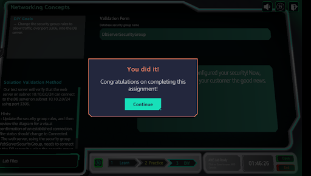

# VPC Network Segmentation Lab

Segment a financial company's network: public web tier, private database tier,
proper routing, and security-group rules.

## Objective

Build a VPC with an Internet Gateway, route traffic correctly, and enforce
tier-level isolation with security groups — then fix a broken path.

## Steps completed

1. **Client consultation** — gathered requirements for a financial company's
   network segmentation needs.
2. **VPC setup** — VPC `vpc-0038a8ae943bb557c`; created/updated **RouteTable2**
   (`rtb-07f21772e33265c60`) with routes through the Internet Gateway.
   
3. **WebServerSecurityGroup** (`sg-0e7511947c03ce267`) — configured inbound rules
   and outbound rules (HTTP/HTTPS/MYSQL outbound).
   
   
4. **Diagnosed blocked traffic** — the architecture diagram showed a **red X
   between the Web Server and the Database**: web→DB traffic was blocked.
   
5. **DIY fix** — changed the **DbServerSecurityGroup** (`sg-09bdaa38352513e0b`)
   inbound rules to allow **MySQL/Aurora (port 3306)** into the DB server.
   Console confirmed "Inbound security group rules successfully modified."
   
   
6. **Completion** — green connected architecture; all Practice + DIY goals met.
   

## Key takeaways

- Security groups are **stateful**: allowing inbound response traffic automatically
  permits the outbound reply — but each tier still needs its own rules.
- Diagrams are diagnostic tools: the red-X architecture immediately localized the
  problem to the DB tier's inbound rules.
- Segmentation only works if you open *exactly* what's needed — port 3306 for the
  DB, nothing more.
